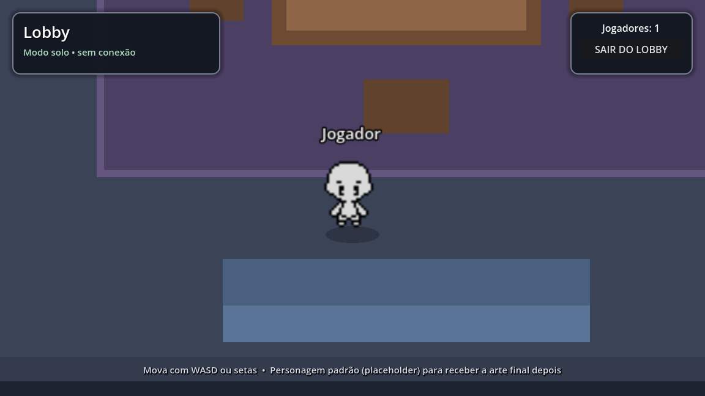
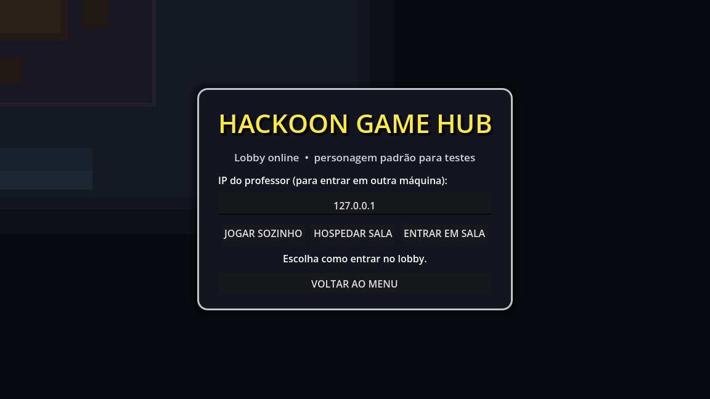

# Lobby e fechamento do ciclo — Hackoon Game Hub

Este documento registra a análise do projeto, o que foi implementado para
fechar o ciclo atual e como continuar a partir daqui.

## 1. Análise do projeto

O **Hackoon Game Hub** é um jogo educativo 2D top-down feito em **Godot 4.6 com
C#**, apoiado por uma solução .NET com:

- `Models` — `Usuario`, `Professor`, `Aluno`, `Sala` e `NetworkPacket`.
- `Repository` — PostgreSQL (`Npgsql`) e descoberta do servidor por **UDP**
  (porta `11000`).
- `Service` — regras de login, salas, alunos e broadcast do professor.
- `Game` — cenas e scripts do Godot.

Antes deste ciclo, o fluxo já tinha:

- menu inicial;
- cadastro/login de professor;
- cadastro/listagem de salas;
- descoberta do professor pelo aluno;
- escolha de um aluno/persona;
- uma cena `LobbyPrincipal` com lógica inicial de multiplayer.

O que faltava para o ciclo fechar:

1. O `LobbyPrincipal` **não estava ligado a nenhuma tela**. Nenhum botão levava
   até ele.
2. A tela de espera do professor (`LobbyPanel`) não tinha um botão para abrir o
   lobby.
3. Depois de escolher o persona, o aluno permanecia na tela de listagem.
4. O broadcast do aluno enviava o pacote **duas vezes serializado** (`JSON`
   dentro de uma string JSON), então o professor não conseguia decodificar a
   entrada do aluno.
5. O `LobbyPanel` chamava `SendMessage` a cada frame, criando uma tarefa de
   broadcast infinita por frame.
6. O personagem remoto se movia duas vezes (pelo sincronizador e pelo
   `_PhysicsProcess`).
7. Não havia câmera, cenário, nome do jogador nem modo de teste sem rede.
8. O `Personagem.tscn` usava o próprio `AnimatedSprite2D` como raiz, o que
   dificultava adicionar câmera, sombra e nome.

## 2. O que foi implementado

### 2.1 Lobby jogável

Prévia do lobby em modo solo:



Tela de entrada (solo, hospedar ou entrar por IP):



Cena: `Game/Scenes/Personagem/LobbyPrincipal.tscn`

- Cenário placeholder de sala (piso, tapete, paredes, palco, mesa, cadeiras,
  sofá e plantas) feito com nós `Polygon2D` nomeados. Tudo pode ser substituído
  por arte final sem mexer na lógica.
- Três formas de iniciar:
  - **JOGAR SOZINHO** — modo offline para testar a arte e a movimentação.
  - **HOSPEDAR SALA** — abre um servidor ENet na porta `7777`.
  - **ENTRAR EM SALA** — conecta no IP informado (IP do professor).
- HUD com nome da sala, status da conexão, contador de jogadores e botão de
  sair.
- Câmera que segue o personagem local, com zoom `2x` e suavização.
- Nome do jogador flutuando sobre o personagem.
- Sincronização de posição, direção, animação e nome pelo
  `MultiplayerSynchronizer`.
- Atalho de desenvolvimento `--lobby-solo` para abrir direto no modo solo.

### 2.2 Personagem padrão (placeholder)

Cena: `Game/Scenes/Personagem/Personagem.tscn`

A cena foi reorganizada para:

```
Personagem (Node2D)
├── Shadow (Polygon2D)
├── Sprite (AnimatedSprite2D)
├── NameLabel (Label)
├── Camera2D
└── MultiplayerSynchronizer
```

- O visual está **somente** no nó `Sprite`.
- Para estilizar depois, troque o `SpriteFrames` do nó `Sprite` no editor.
  Nenhum script precisa ser alterado.
- A sombra (`Shadow`) e o nome (`NameLabel`) também são nós separados.
- Movimento com **WASD** ou **setas**, com animação de idle e caminhada nas
  8 direções.
- Limite de área (`MovementBounds`) definido pelo lobby para o personagem não
  sair do piso.

### 2.3 Integração do fluxo

- `FormsSalas.cs`: ao escolher uma sala, grava a sala, o nome do jogador e o
  modo `Host` na `SessionManager` e **vai direto para o lobby**
  (`LobbyPrincipal.tscn`) — o painel do professor já abre junto com o lobby,
  e a sessão já fica anunciada para os alunos.
- `LobbyPrincipal.cs`: ao hospedar, mantém o **broadcast da sessão ligado**
  (antes ele era parado ao abrir o lobby), para que os alunos sempre
  encontrem a sala e entrem direto no lobby, sem esperar o professor abrir
  nada.
- `LobbyPanel.cs` (tela de espera antiga): mantida no projeto, mas **fora do
  fluxo** — o painel dentro do lobbycumpre o papel de espera e gestão.
- `FormsAlunos.cs`: ao escolher um aluno, envia o persona, configura o IP do
  professor e abre o lobby como cliente.
- `AlunoEntrar.cs`: mostra a sessão aberta pelo professor (sala, professor e
  IP), trata ausência de professor e falha de banco com uma mensagem amigável,
  e guarda tudo na sessão.
- `SessionManager.cs`: passou a carregar `lobbyMode`, `lobbyIp`, `hostName`,
  `playerName` e `roomName`.

### 2.4 Correções de rede e estabilidade

- **Dupla serialização do persona** corrigida em `AlunoService.SendMyPersona`.
- Broadcasts com **guardas estáticas** para não criar uma tarefa infinita a cada
  chamada (`ProfessorService` e `AlunoService`).
- Tempo limite de **15 s** para descobrir o professor e de **20 s** para o
  professor esperar um aluno, evitando telas presas para sempre.
- `BroadcastUDP` reescrito para fechar o socket corretamente em
  `StopListening`, com controle de geração para não deixar ouvintes órfãos.
- `RegisterProfessor` agora é `async Task` e é aguardado no cadastro.
- O personagem remoto não é mais movido localmente: só a autoridade dele aplica
  movimento; os demais recebem a posição pelo sincronizador.

### 2.5 Dashboard do professor e telas redesenhadas

- O professor **não cria personagem no lobby**: ao hospedar, ele vê a
  **dashboard** (painel lateral) com nome da sala, status, contador e lista de
  alunos conectados, além dos botões **ENCERRAR CONEXÃO** (fecha a sessão para
  todos os alunos) e **SAIR**. Uma câmera fixa (`HostCamera`) mostra o lobby.
- Os alunos entram como personagens e aparecem no lobby e na dashboard.
- Novo tema compartilhado `Game/Assets/Theme/HackoonTheme.tres` (fundo
  escuro/marinho + amarelo Hackoon) aplicado em `InitialScene`, `FormsProfessor`,
  `FormsSalas`, `LobbyPanel`, `AlunoEntrar`, `AlunoForms` e no lobby
  (HUD/dashboard/overlay). Textos “placeholder” na tela (USERNAME, NAME, BOTÃO
  etc.) foram removidos.

### 2.5.1 Lobby sempre aberto + botão INICIAR JOGO

**Problema:** o lobby (ENet) só abria quando o professor apertava **ABRIR
LOBBY** na tela de espera. Com o professor parado no painel, os alunos ficavam
conectando e reconectando sem nunca ver o lobby.

**Solução:**

- O professor entra **direto no lobby** ao escolher a sala
  (`FormsSalas.cs` → `LobbyPrincipal.tscn`), e o painel dele fica **dentro** do
  lobby.
- Ao hospedar, o lobby mantém o **broadcast da sessão ligado**
  (`ProfessorService.SendMessage` em `StartHost`), então o aluno sempre
  encontra a sala e entra direto, a qualquer momento.
- O botão **INICIAR JOGO** (no painel do professor) fecha o painel e leva
  **todos** (professor pela `HostCamera` e alunos) para o lobby, que é onde os
  minigames vão ficar — o contêiner reservado é o nó **`World/Jogos`**.
  - A mudança de estado é enviada por **RPC** (`AplicarModoJogo`, confiável) para
    todos os conectados.
  - Aluno que entra **depois** do jogo começado já entra no modo jogo
    (`RpcId` no `OnPeerConnected`).
  - O professor volta ao painel quando quiser pelo botão **PAINEL** do HUD
    (visível só na máquina dele).
- Atalho de desenvolvimento: `--lobby-host --lobby-iniciar[=SEGUNDOS]`
  dispara o mesmo botão por linha de comando.

### 2.6 Descoberta por UDP robusta (mesmo PC e rede local)

`Repository/Network/BroadcastUDP.cs` foi reescrito:

- **Duas portas** para professor e aluno poderem rodar na mesma máquina:
  - `11000` — professor (recebe os pacotes `ENTRADA` dos alunos);
  - `11001` — aluno (recebe os anúncios `DESCOBERTA_SERVIDOR` do professor).
- **Envio multi-destino** em cada anúncio: `127.0.0.1` (mesmo PC),
  `255.255.255.255` e o **broadcast dirigido de cada interface** (ex.
  `192.168.15.255`), que atravessa roteadores/APs que descartam o
  broadcast limitado.
- O aluno é **cliente do banco**: `DB.Connect(ip, iniciarLocal: false)` — ele
  conecta no PostgreSQL do professor (IP e porta vindos do broadcast) em vez
  de subir um banco próprio.
- Quando o professor encerra a conexão, o aluno para o envio do persona e
  volta à tela inicial ("O professor encerrou a conexão.").

### 2.7 Tela de conta da criança e cor do personagem por shader

Novo fluxo do aluno (funciona no mesmo PC e na rede):

1. `AlunoEntrar` — encontra a sessão do professor pela rede;
2. **`AlunoConta` (nova)** — a criança escolhe **CRIAR CONTA** (nick, nome,
   turma, senha opcional) ou **JÁ TENHO CONTA** (nick + senha), escolhe a
   **cor do personagem** e aperta **JOGAR**;
3. O personagem padrão entra no lobby com a cor escolhida.

Detalhes técnicos:

- A cor é aplicada pelo shader `Game/Assets/Shaders/personagem_tint.gdshader`
  (uniform `tint_color` multiplicativo — branco = arte original);
- A cor vai na sessão (`SessionManager.personagemColorHex`) e é replicada
  para todos pela propriedade `SyncColor` do `Personagem` via
  `MultiplayerSynchronizer`;
- O preview da tela de conta é o **próprio `Personagem.tscn`** em modo
  `Controllable = false` (sem câmera e sem movimento), então qualquer arte
  nova do personagem aparece na hora no preview;
- Contas: `AlunoService.RegisterAluno` (agora `async Task`, sem engolir erro)
  e `AlunoService.LoginAluno`/`Existe` — validados contra o banco.

### 2.8 Kit de interface compartilhado (`UIHelpers`)

`Game/Scripts/UI/UIHelpers.cs` concentra a paleta (amarelo Hackoon, fundo
escuro, cores de texto/status) e peças prontas (cartões, linhas, textos,
selos "ONLINE", botões redondos de cor). As listas de alunos das telas
(`LobbyPanel`, dashboard, `FormsAlunos`) já usam o kit — para mudar o visual
das listas em todas as telas, mexe em um arquivo só.

Ferramenta de screenshots para conferir o visual:

```bash
Godot --path Game --rendering-driver opengl3 \
  res://Scenes/Dev/ScreenshotRunner.tscn -- \
  res://Scenes/Forms/AlunoConta.tscn /tmp/opencode/conta.png
```

## 3. Como testar

### 3.1 Lobby sozinho (sem banco e sem rede)

No editor Godot, abra `Scenes/Personagem/LobbyPrincipal.tscn` e execute com
**F6**. Ou, pelo terminal:

```bash
godot --path HackoonGameHub/Game \
  res://Scenes/Personagem/LobbyPrincipal.tscn -- --lobby-solo
```

### 3.2 Host e cliente na mesma máquina

```bash
# Terminal 1
godot --path HackoonGameHub/Game \
  res://Scenes/Personagem/LobbyPrincipal.tscn -- --lobby-host

# Terminal 2
godot --path HackoonGameHub/Game \
  res://Scenes/Personagem/LobbyPrincipal.tscn -- --lobby-join=127.0.0.1
```

Resultado esperado: o **host (professor) não tem personagem** — ele vê a
**dashboard** com a lista de alunos conectados e o botão **ENCERRAR CONEXÃO**.
O **cliente (aluno)** aparece como personagem no lobby, com nome e animação
sincronizados. Quando o professor encerra a sessão, o cliente recebe
“O professor encerrou a conexão.” e volta à tela inicial.

### 3.3 Fluxo completo (com banco)

1. Execute o jogo pela cena principal. O **PostgreSQL embutido** sobe
   automaticamente na máquina do professor (na porta `5432`, ou na primeira
   porta livre se a 5432 estiver ocupada).
2. Professor: cadastre-se/entre → crie uma sala → entre na sala → tela de
   espera (que mostra os alunos entrando em tempo real) → **ABRIR LOBBY**.
3. Aluno (mesmo PC ou outro PC da mesma rede): entre no jogo → a tela mostra a
   **sessão aberta pelo professor** (nome da sala, professor, IP e porta do
   banco vindos do broadcast) → escolha o aluno → o lobby conecta
   automaticamente no IP do professor.

> Portas usadas: `11000` e `11001` para descoberta UDP (professor/aluno) e
> `7777` para o lobby ENet, além da porta do PostgreSQL (padrão `5432`, ou a
> livre seguinte). Libere todas no firewall da máquina do professor.

### 3.4 PostgreSQL embutido multiplataforma

O app usa um **PostgreSQL portátil** copiado para a saída do build conforme o
sistema operacional:

| SO | Pasta no projeto | Pasta na saída do build |
| --- | --- | --- |
| Windows | `HackoonGameHub/pgsql/pgsql` | `pgsql/windows/` |
| Linux | `HackoonGameHub/pgsql/linux` | `pgsql/linux/` |
| macOS | `HackoonGameHub/pgsql/macos` | `pgsql/macos/` |

Comportamento (`Repository/Postgress/DB.cs`):

- Na primeira execução, `initdb` cria o cluster em `pgsql/<so>/data`;
- `pg_ctl` inicia o servidor (`listen_addresses = '*'`, `trust` na rede local);
- Se a porta `5432` já estiver ocupada (ex.: um Docker de teste), o servidor
  sobe automaticamente na primeira porta livre (5433, 5434...) e a porta
  escolhida vai no broadcast UDP (`Port`), então o aluno conecta na porta
  certa sem configurar nada;
- Com `HACKOON_PG_PORT` definida, essa porta é usada exatamente como foi
  configurada (sem fallback);
- Se um servidor de uma execução anterior ainda estiver rodando (app fechou
  sem parar o banco), o app o detecta, reutiliza a porta gravada no
  `postgresql.conf` e o encerra normalmente ao sair;
- Ao fechar o jogo, o servidor é parado **somente se foi iniciado/adotado pelo
  app**; Docker/serviços externos não são afetados.

Validação feita em 11/11/2026 no Linux (binários Zonky PostgreSQL 16.2) usando
o `DB.cs` real com `HACKOON_PG_PORT=5433`: initdb, start, conexão, criação das
tabelas, INSERT/SELECT e `StopLocalServer` (processo encerrado corretamente).

### 3.5 Validação com PostgreSQL real

O ciclo de backend foi validado em 10/11/2026 com um PostgreSQL 14.21 em Docker
(`localhost:5432`), usando a mesma conexão do jogo
(`postgres` / `postgres` / senha `root1234`):

- conexão e criação automática das tabelas (`salas`, `alunos`, `professores`);
- cadastro e login de professor com senha BCrypt;
- criação de sala;
- anúncio `LOBBY_ABERTO` por UDP e descoberta pelo aluno (pacote recebido de
  `192.168.15.12`, sem dupla serialização);
- conexão do aluno ao banco do professor pelo IP descoberto;
- envio da persona (`ENTRADA` / `ENTROU_SERVIDOR`) e leitura do aluno no banco
  pelo professor.

Também foi validado o lobby ENet: host na porta `7777` e cliente conectando em
`127.0.0.1`, com spawn dos dois personagens e autoridade correta em cada um.

Correções encontradas durante essa validação:

- `AlunoDB.GetAlunoById` consultava uma coluna inexistente (`createdAt`) e
  retornava um registro composto; agora usa `created_at` e as mesmas colunas de
  `GetAlunoByUsername`.
- `ProfessorDB.Listar` lia `created_at` no índice errado.
- `FormsSalas` agora abre normalmente quando ainda não existe nenhuma sala no
  banco (lista vazia em vez de exceção).

## 4. Limitações atuais / próximos passos

- O cenário do lobby é um **placeholder** de formas geométricas; a arte final
  ainda será produzida.
- O personagem é um **placeholder**: troque os sprites no nó `Sprite`.
- Não há colisão física com mesas/paredes; o limite atual é apenas a área do
  piso (`MovementBounds`). Para evoluir, trocar o `Node2D` por
  `CharacterBody2D` e adicionar `CollisionShape2D`/`StaticBody2D`.
- O lobby não tem lista visual de jogadores no HUD do aluno; a **dashboard do
  professor** cobre isso no lado host (lista de alunos conectados com nomes).
- Não há tela de criação de personagem; o botão existente foi desabilitado com
  o texto “EM BREVE”.
- O host ainda não escolhe o mapa/fase; o lobby é uma sala única.
- A exportação para Windows/Linux ainda precisa ser validada na máquina de
  apresentação. O PostgreSQL embutido já foi validado no Linux; a pasta
  `pgsql/windows` (binários `.exe` que já existem no repositório) segue o mesmo
  fluxo e aguarda um teste no Windows.
- O botão “SAIR” do dashboard volta ao menu inicial. Se quiser voltar para a
  tela de salas mantendo a sessão do professor, ajuste `LeaveLobby` em
  `LobbyPrincipal.cs`.

## 5. Arquivos principais alterados

| Arquivo | Mudança |
| --- | --- |
| `Game/Scenes/Personagem/LobbyPrincipal.tscn` | Cenário, HUD, overlay de entrada, **dashboard do professor**, HostCamera, **botão INICIAR JOGO**, botão PAINEL e contêiner `World/Jogos` |
| `Game/Scripts/Personagem/LobbyPrincipal.cs` | Modos solo/host/cliente, spawn (só clientes ganham personagem), dashboard, **broadcast sempre ligado no host**, **RPC do INICIAR JOGO**, encerramento de sessão |
| `Game/Scripts/SceneControlls/FormsSalas.cs` | Entra direto no lobby (sessão já aberta e anunciada para os alunos) |
| `Game/Scenes/Personagem/Personagem.tscn` | Separação em Sprite/Shadow/Nome/Câmera |
| `Game/Scripts/Personagem/Personagem.cs` | Movimento WASD/setas, animação, câmera e nome |
| `Game/Scenes/LobbyPanel.tscn` | Tela de espera redesign (tema, lista de alunos, ABRIR LOBBY) — **fora do fluxo** (o painel dentro do lobby faz esse papel) |
| `Game/Scripts/SceneControlls/LobbyPanel.cs` | Broadcast com nome da sala, escuta contínua de alunos e abertura do lobby |
| `Game/Scenes/AlunoEntrar.tscn` | Tela de sessões redesign (mostra sala/professor/IP) |
| `Game/Scripts/SceneControlls/AlunoEntrar.cs` | Leitura da sessão (incl. `Room`), cartão da sessão e retry |
| `Game/Scenes/Forms/AlunoForms.tscn` | Escolha de personagem redesign |
| `Game/Scripts/SceneControlls/FormsAlunos.cs` | Aluno entra no lobby após escolher persona |
| `Game/Scenes/InitialScene.tscn` | Menu inicial redesign (tema compartilhado) |
| `Game/Scenes/Forms/FormsProfessor.tscn` | Login do professor redesign, senha oculta |
| `Game/Scenes/Forms/FormsSalas.tscn` | Gerenciamento de salas redesign |
| `Game/Scenes/Forms/AlunoConta.tscn` | **Nova** tela de conta da criança (criar/acessar + cor + preview + JOGAR) |
| `Game/Scripts/SceneControlls/AlunoConta.cs` | Alternância CRIAR CONTA/JÁ TENHO CONTA, paleta de cores e entrada no lobby |
| `Game/Scripts/UI/UIHelpers.cs` | Kit de interface compartilhado (paleta, cartões, selos, botões de cor) |
| `Game/Assets/Shaders/personagem_tint.gdshader` | Shader de cor do personagem (uniform `tint_color`) |
| `Game/Scenes/Dev/ScreenshotRunner.tscn` + `Game/Scripts/Dev/ScreenshotRunner.cs` | Ferramenta de screenshots para conferir o visual das telas |
| `Game/Assets/Theme/HackoonTheme.tres` | Tema compartilhado (escuro + amarelo Hackoon) |
| `Game/Scripts/SessionManager.cs` | Dados de sessão do lobby e parada do banco ao sair |
| `Repository/Postgress/DB.cs` | PostgreSQL embutido multiplataforma (initdb/pg_ctl, porta e stop) |
| `Repository/Repository.csproj` | Cópia da pasta `pgsql` do SO atual para a saída do build |
| `Repository/Network/BroadcastUDP.cs` | Portas divididas (`11000` professor / `11001` aluno), broadcast multi-destino (loopback + 255.255.255.255 + sub-rede) e encerramento correto do socket |
| `Repository/Postgress/AlunoDB.cs` | Correção da consulta `GetAlunoById` |
| `Repository/Postgress/ProfessorDB.cs` | Correção do índice de `created_at` em `Listar` |
| `Service/Usuario/AlunoService.cs` | Correção do pacote de persona e guarda de envio; `RegisterAluno` async sem engolir erro; novo `Existe` |
| `Service/Usuario/ProfessorService.cs` | Broadcast único (agora com o nome da sala e a porta do banco), timeout e cadastro aguardado |

## 6. Como estilizar o personagem depois

1. Abra `Game/Scenes/Personagem/Personagem.tscn`.
2. Selecione o nó **Sprite**.
3. Em `Sprite Frames`, substitua/edite as animações:
   - `idleDown`, `idleLeft`, `idleRight`, `idleUp`;
   - `down`, `left`, `right`, `up`;
   - `idleDownLeft`, `idleDownRight`, `idleTopLeft`, `idleTopRight`;
   - `downLeft`, `downRight`, `topLeft`, `topRight`.
4. Ajuste a escala do nó `Sprite` se a arte tiver outro tamanho.
5. Ajuste `Shadow` e `NameLabel` conforme o novo visual.

O código procura as animações por nome; se alguma não existir, ele volta para
`idleDown` sem travar.
